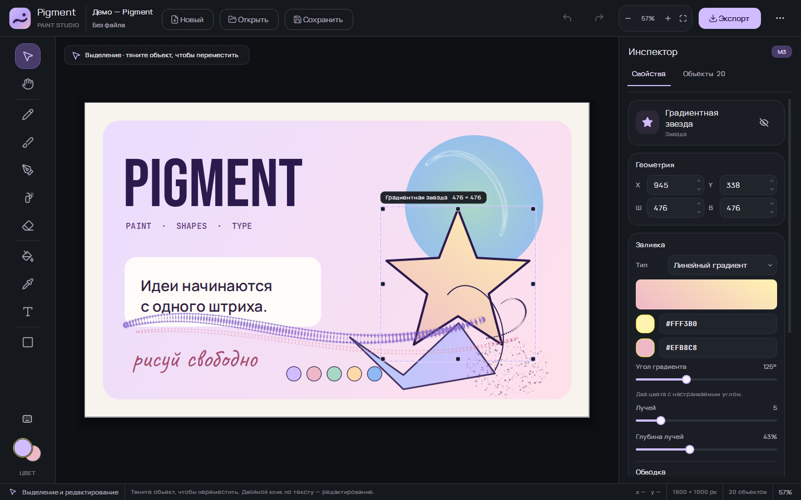
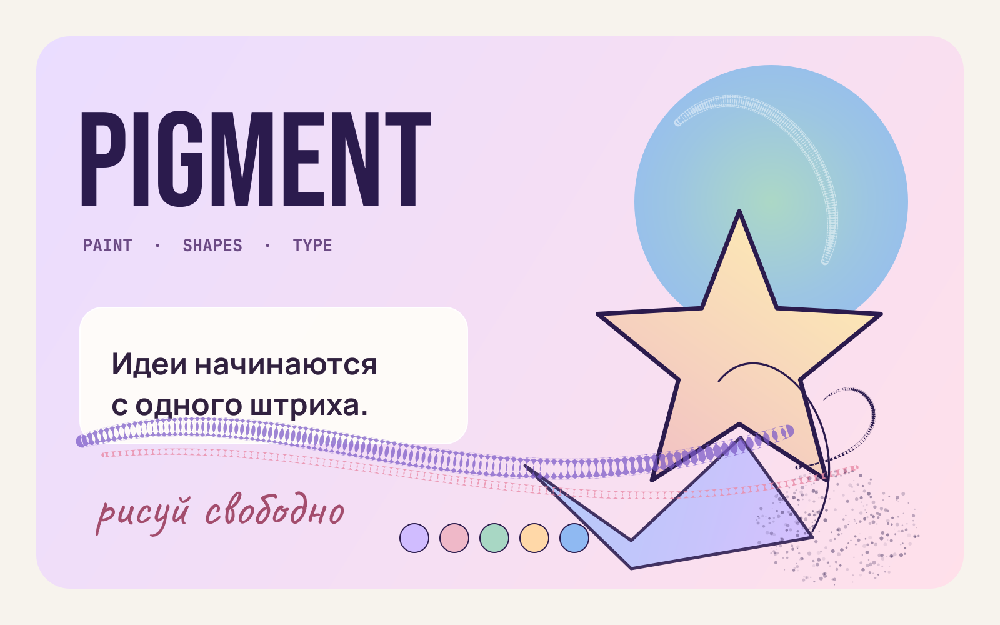
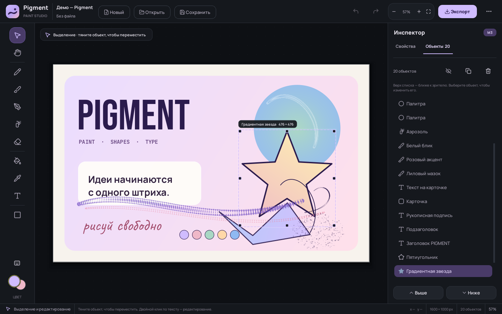

# Pigment — Paint-студия на Python

Аналог Paint с современным тёмным интерфейсом в духе **Material 3**. Фигуры, текст и штрихи остаются редактируемыми объектами: их можно выделять, двигать, масштабировать, перекрашивать, заливать градиентом и менять порядок слоёв.



## Возможности

- **Рисование**
  - карандаш с лёгкой графитовой текстурой;
  - мягкая кисть с имитацией нажима от скорости;
  - каллиграфическое перо с переменной толщиной;
  - баллончик с естественным разбросом точек;
  - ластик;
  - заливка фигуры или фона;
  - пипетка.
- **2D-фигуры**
  - линия, прямоугольник, скруглённый прямоугольник, эллипс, звезда и многоугольник;
  - `Shift` — ровные пропорции / угол 45°, `Alt` — фигура из центра;
  - выделение, перемещение и масштабирование за 8 маркеров;
  - редактирование геометрии в инспекторе;
  - порядок слоёв, дублирование, скрытие и удаление.
- **Градиенты**
  - сплошная, линейная и радиальная заливка;
  - два цвета и угол линейного градиента;
  - живой предпросмотр в инспекторе.
- **Текст**
  - создание кликом по холсту и редактирование двойным кликом;
  - выбор шрифта, размера, жирности, курсива, подчёркивания и выравнивания;
  - 7 бесплатных шрифтов уже в комплекте;
  - текст остаётся объектом: его можно двигать, масштабировать и перекрашивать.
- **Работа с документом**
  - новый холст с пресетами размеров и цветом фона;
  - сохранение и открытие проекта в `.pigment` (читаемый JSON);
  - экспорт PNG/JPEG, копирование PNG в буфер;
  - вставка изображений из файла или буфера, drag & drop;
  - демо-работа для знакомства с возможностями.
- **Удобства**
  - отмена/повтор до 80 действий;
  - масштаб 5–800%, вписать холст, панорамирование;
  - список объектов с переходом к выбранному слою;
  - автосохранение цвета, размера и настроек инструмента между объектами;
  - тёмная тема Material 3, кастомные SVG-иконки, плавные уведомления.

## Установщик для Windows (один файл)

**[`dist/PigmentSetup.exe`](dist/PigmentSetup.exe)** — один самодостаточный установщик. Python, Qt, шрифты и ресурсы уже внутри. ZIP-файлов и распаковки вручную нет.

1. Скопируйте `PigmentSetup.exe` на **Рабочий стол** или в «Загрузки».
2. Запустите его двойным кликом. Установка займёт несколько секунд и покажет окно прогресса.
3. На Рабочем столе появится ярлык **Pigment**, приложение сразу запустится. Установщик после этого можно удалить.
4. Дальше запускайте Pigment одним кликом с ярлыка.

Важно: запускайте установщик из обычной папки (Рабочий стол, Загрузки), а **не из папки проекта/песочницы**. Для файлов из рабочего каталога Windows иногда включает ограниченный уровень целостности; установщик обнаружит это и попросит скопировать его на Рабочий стол.

- Устанавливается **для текущего пользователя**, без прав администратора.
- Папка установки: `%LOCALAPPDATA%\Programs\Pigment`.
- **Временный каталог не используется** — проверено с `TEMP` и `TMP`, указывающими на несуществующую папку.
- Ярлыки создаются на Рабочем столе и в меню «Пуск».
- Удаление: «Параметры Windows» → «Приложения» → **Pigment Paint**, либо ярлык «Удалить Pigment» в меню «Пуск».
- Размер установщика: **38,9 МБ**.
- SHA-256: `64A4B048DD728C605083C2BB8184F8836BD68E4806DE549888C097BA525A5CF1`
- Файл **не подписан** сертификатом. SmartScreen может показать предупреждение — нажмите «Подробнее» → «Выполнить в любом случае».

Проверено: установка с недоступным TEMP, создание ярлыка, запуск установленного приложения, запуск с ярлыка и полное удаление.

Пересобрать установщик:

```bat
build_installer.bat
```

Для сборки нужен PyInstaller и MinGW-w64 (`gcc`, `g++`, `windres`); на этой машине MinGW находится в `.tools/w64devkit` и определяется автоматически. Готовый результат — `dist/PigmentSetup.exe`.

## Запуск из исходников

В папке проекта уже есть виртуальное окружение `.venv` с PyQt6.

1. Дважды щёлкните **`run.bat`**.
2. Если окружение отсутствует, запустите **`setup.bat`**, затем снова `run.bat`.
3. Для запуска с консолью и сообщениями об ошибках используйте **`run_console.bat`**.

### Запуск вручную

```bat
python -m venv .venv
.venv\Scripts\activate
pip install -r requirements.txt
python main.py
```

Требуется Python **3.10+**; проект проверен на Python 3.12 и PyQt6 6.7.1.

### VS Code

1. Откройте папку `pigment-paint` в VS Code.
2. Установите расширение **Python**.
3. Выберите интерпретатор `.venv\Scripts\python.exe`.
4. Нажмите **F5** — конфигурация `Pigment: запуск` уже лежит в `.vscode/launch.json`.

## Горячие клавиши

| Клавиши | Действие |
|---|---|
| `V`, `H` | выделение, рука |
| `P`, `B`, `N`, `A`, `E` | карандаш, кисть, перо, баллончик, ластик |
| `G`, `I`, `T`, `R` | заливка, пипетка, текст, фигуры |
| `Ctrl+Z` / `Ctrl+Shift+Z` | отменить / повторить |
| `Ctrl+D` / `Del` | дублировать / удалить объект |
| `Ctrl+N`, `Ctrl+O`, `Ctrl+S` | новый холст, открыть, сохранить |
| `Ctrl+E` | экспорт PNG/JPEG |
| `Ctrl+0`, `Ctrl+1` | вписать холст, масштаб 100% |
| `Ctrl+колесо` | масштаб |
| `Space` + перетаскивание | перемещение холста |
| `Shift` / `Alt` при рисовании | ровные пропорции / из центра |
| `F1` | все горячие клавиши |

Одиночные буквенные горячие клавиши автоматически отключаются, пока курсор находится в поле ввода — можно спокойно печатать текст.

## Бесплатные шрифты

Все шрифты распространяются по лицензии **SIL Open Font License 1.1**, тексты лицензий находятся в [`assets/fonts/licenses`](assets/fonts/licenses).

| Шрифт | Назначение |
|---|---|
| Manrope | интерфейс и основной текст |
| Inter | нейтральный гротеск |
| Playfair Display | акцидентный антиквенный |
| Caveat | рукописный |
| Bebas Neue | плотный заголовочный |
| JetBrains Mono | моноширинный |
| Pacifico | декоративный |

В списке также доступны системные шрифты Windows (Segoe UI, Georgia, Arial и др.).

## Управление холстом

- **Мышь**: рисование, выделение, перетаскивание, маркеры масштаба.
- **Средняя кнопка** или **рука** — панорамирование.
- **Ctrl+колесо** — масштаб относительно курсора.
- **Пробел** временно включает руку.
- **Двойной клик** по тексту открывает редактор на холсте (`Ctrl+Enter` — применить, `Esc` — отмена).
- **Правая кнопка** по объекту открывает контекстное меню: дублировать, порядок, скрыть, удалить.

## Формат проекта

Файл `.pigment` — обычный JSON в UTF-8. В нём хранятся размер и фон холста, все объекты, их геометрия, стили, градиенты, текст и встроенные изображения в base64. Такой файл можно открыть вручную, проверить в редакторе или обработать скриптом.

```json
{
  "format": "pigment-document",
  "version": 1,
  "width": 1600,
  "height": 1000,
  "background": "#FFFFFF",
  "objects": [
    {
      "kind": "rounded_rect",
      "fill_mode": "linear",
      "fill": "#D0BCFF",
      "fill2": "#EFB8C8",
      "gradient_angle": 32
    }
  ]
}
```

Демо-проект: [`assets/examples/pigment-demo.pigment`](assets/examples/pigment-demo.pigment). Его можно открыть через **«Ещё» → «Открыть демо-работу»** или обычным открытием файла.

## Скриншоты

| Демо-рисунок | Панель объектов |
|---|---|
|  |  |

## Структура проекта

```
pigment-paint/
├─ dist/PigmentSetup.exe   установщик: один файл, без TEMP и ZIP
├─ main.py                 точка входа
├─ app/
│  ├─ main_window.py       окно, меню, сохранение, экспорт
│  ├─ canvas.py            холст, инструменты, выделение, история
│  ├─ inspector.py         панель свойств и объектов
│  ├─ models.py            документ, фигуры, сериализация
│  ├─ renderer.py          отрисовка QPainter и экспорт
│  ├─ theme.py             палитра Material 3 и QSS
│  ├─ icons.py             SVG-иконки и логотип
│  ├─ widgets.py           M3-компоненты
│  ├─ dialogs.py           диалоги нового холста и справки
│  └─ demo.py              демонстрационная работа
├─ assets/
│  ├─ fonts/               7 OFL-шрифтов + лицензии
│  ├─ screenshots/         изображения для README
│  ├─ examples/            демо-проект
│  └─ icon.ico / icon.png  иконка приложения
├─ packaging/
│  ├─ installer.cpp        нативный установщик
│  ├─ uninstaller.cpp      удаление приложения
│  ├─ miniz/               распаковка ZIP без TEMP
│  └─ *.rc / *.manifest    иконка и метаданные
├─ scripts/
│  ├─ make_assets.py       пересборка скриншотов и демо
│  ├─ build_exe.py         сборка onedir через PyInstaller
│  └─ build_native_installer.py  сборка финального EXE
├─ tests/                  тесты моделей, холста и интерфейса
├─ .vscode/                запуск и тесты в VS Code
├─ run.bat / setup.bat
├─ build_exe.bat / build_installer.bat
├─ requirements.txt
└─ requirements-build.txt
```

## Тесты

```bat
.venv\Scripts\python.exe -m pip install -r requirements-dev.txt
set QT_QPA_PLATFORM=offscreen
.venv\Scripts\python.exe -m pytest -q
```

Проверяются сериализация, геометрия, попадания по фигурам, рисование, undo/redo, создание текста, выделение и масштабирование, сборка инспектора, сохранение/открытие проекта и экспорт изображения.

## Особенности реализации

- Холст целиком рисуется через `QPainter`, поэтому экспорт совпадает с экранным видом.
- Свободные штрихи хранят профиль толщины: кисть и перо выглядят «живыми», а не как обычная линия.
- Формы и текст — векторные объекты, а не пиксели; поэтому их можно редактировать после создания.
- Заливка в духе векторного редактора: клик по фигуре меняет её заливку. Пиксельного flood fill нет.
- Ластик рисует цветом фона холста — это осознанное упрощение без растровых слоёв.
- История хранит снимки документа JSON и ограничена 80 шагами.

## Лицензии

- Код проекта — [MIT](LICENSE).
- Шрифты — SIL Open Font License 1.1, полные тексты в [`assets/fonts/licenses`](assets/fonts/licenses).
- Установщик использует [miniz](https://github.com/richgel999/miniz) (MIT); лицензия лежит в [`packaging/miniz/LICENSE`](packaging/miniz/LICENSE) и включается в установленную версию.
- Иконки нарисованы специально для проекта в стиле Lucide; библиотека Lucide распространяется по ISC.
